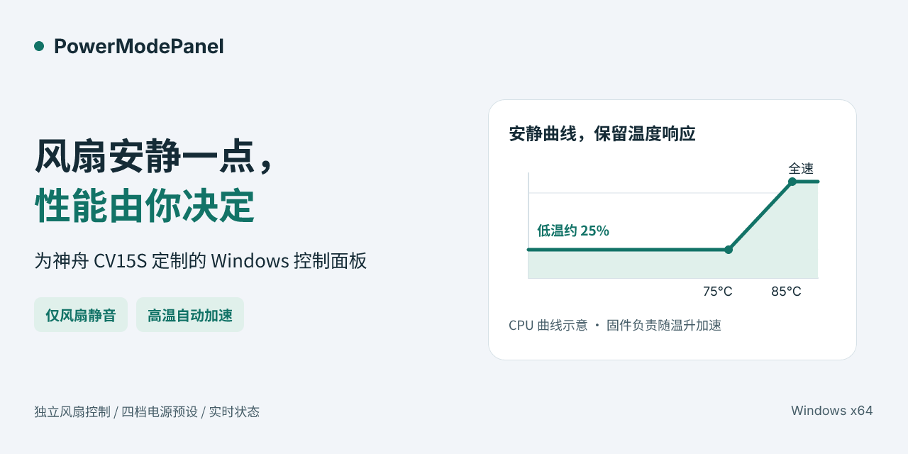
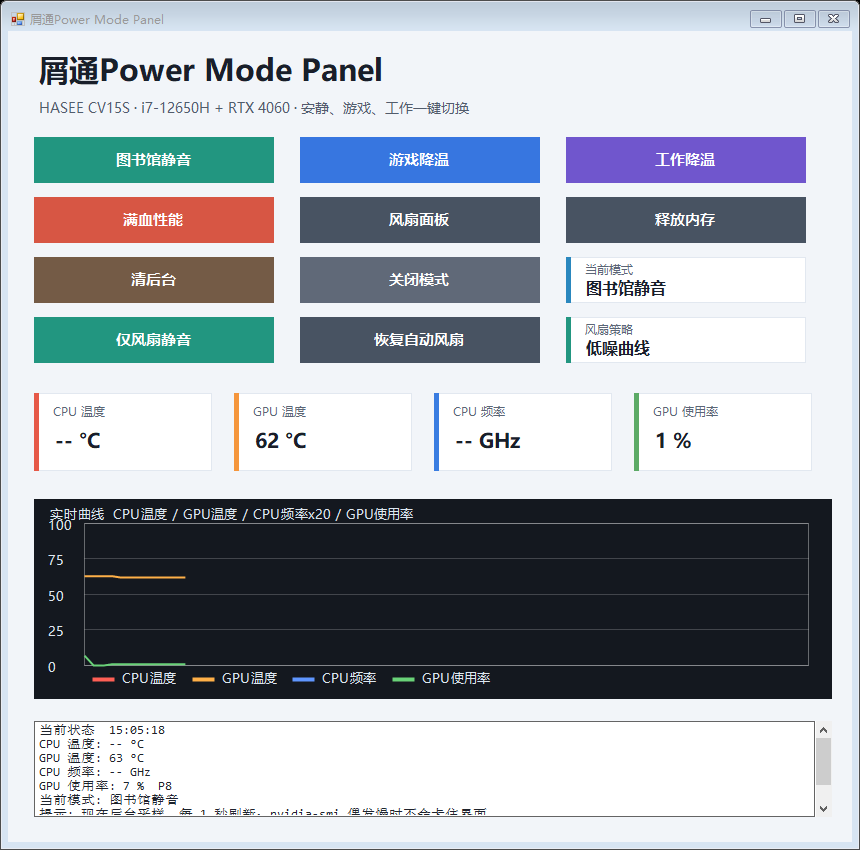
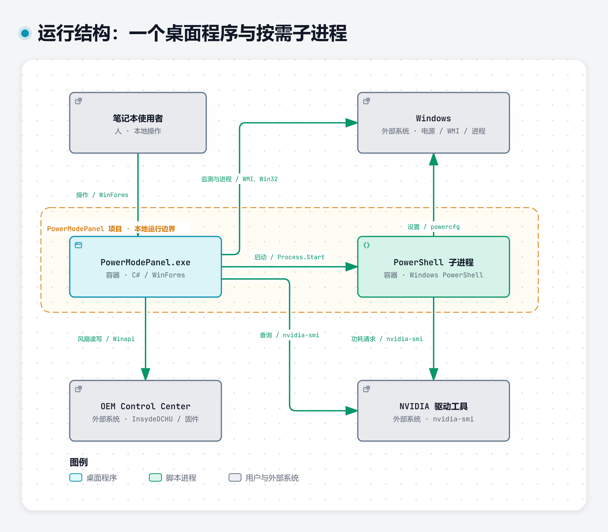

<h1 align="center">PowerModePanel</h1>

<p align="center">让神舟 CV15S 在轻负载时更安静，也能单独选择 CPU 电源策略。</p>

<p align="center"></p>

一个面向 **HASEE/Clevo CV15S** 的 Windows 桌面控制面板。点击“仅风扇静音”，应用低温约 25% 的风扇曲线，保留当前 CPU 电源策略、GPU 设置和 OEM 整机性能模式；温度升高时仍由固件自动加速。需要限制 CPU 发热时，再另选电源档位。

适合拥有该机型、希望在阅读和轻负载工作时减少持续风声的用户，也适合研究 WinForms、Windows 电源管理及 OEM 风扇接口的开发者。当前仅验证这一机型，其他设备先不要尝试写入。

## 导航

[功能与实测](#capabilities) · [一次静音如何完成](#workflow) · [安装与第一次使用](#quick-start) · [架构与技术栈](#architecture) · [故障恢复与限制](#limits) · [许可证与源码](#license)

<a name="capabilities"></a>
## 功能与实测

### 想更安静，不一定要先限制 CPU

当你只想降低风声时，可以跳过整套电源预设，直接使用独立风扇入口：

| 你想做什么 | 点击哪里 | 实际结果 |
| --- | --- | --- |
| 轻负载时减小持续风声 | **仅风扇静音** | 写入自定义低噪曲线，只保存风扇模式；回读曲线并核对 OEM 整机性能模式未变 |
| 交回厂商自动调节 | **恢复自动风扇** | 恢复厂商保存的曲线与斜率，切到 Auto 模式 |
| 通过 CPU 策略降低发热 | 图书馆静音 / 游戏降温 / 工作降温 / 满血性能 | 调整 Windows 均衡电源计划的交流、直流参数；与风扇按钮互相独立 |
| 取消电源档位的偏置 | 关闭模式 | 应用程序内固定的普通均衡参数；风扇策略仍需单独恢复 |

低噪曲线的目标值为 `64/255 ≈ 25.1%`，且不会低于固件起转风量。它保留升温响应：

| 风扇 | 低速区上沿 | 达到全速的温度 |
| --- | --- | --- |
| CPU | 75°C | 85°C |
| GPU | 70°C | 80°C |

在已验证机器的一次轻负载记录中，固件回读约 24.7%，CPU/GPU 风扇约 **2200–2250 转/分**，使用者确认声音已明显改善。这是单机观察，没有分贝测量或满载性能对照。曲线会随温度加速，不能理解为任何负载下都锁定低于 30%，也不能据此承诺帧率不变。

### 真实界面



截图来自本次源码重新构建后的只读启动，没有点击切档按钮。CPU 温度和频率真实显示 `--`；这两张监测卡依赖 Windows WMI，风扇写入前的温度检查则来自 OEM 固件数据包，两者是不同数据源。卡片缺值不能证明固件温度无效；若固件 CPU 温度也无效，程序会拒绝应用。当前模式文字只按电源参数推断，不能把“图书馆静音”视为本次切档或权威状态。上方主视觉是代码曲线示意，本图才是实际界面。

### 四个电源档位，各自改什么

| 档位 | 主要 CPU 设置 | 适用意图 |
| --- | --- | --- |
| 图书馆静音 | 禁用睿频，最大处理器状态 63%，EPP 50 | 愿意限制性能以减少发热的阅读、文档场景 |
| 游戏降温 | P 核最高 3.6 GHz、E 核最高 3.2 GHz；EPP 20/30 | 希望控制游戏时 CPU 的频率上限 |
| 工作降温 | P 核最高 4.0 GHz、E 核最高 3.5 GHz；EPP 15/25 | 给工作任务保留较高频率上限 |
| 满血性能 | 取消上述 P/E 核频率上限；EPP 10/15 | 恢复更积极的 Windows CPU 策略 |

这些是脚本设置的策略目标，实际频率由系统、硬件和负载决定。它们不是 OEM 整机模式切换，也没有已测得的游戏帧率、编译耗时或节能提升。旧静音脚本还会尝试 GPU 40W，但本机驱动不支持该功耗限制，不能将脚本的 `Done` 当作生效证明。

### 状态与辅助操作

| 功能 | 能看到或完成什么 | 使用时需要知道 |
| --- | --- | --- |
| 实时监测 | CPU 温度/频率、GPU 温度/使用率，最近 80 个有效样本的趋势图 | 每秒尝试后台采样；不可用字段显示 `--`，不阻塞界面 |
| 风扇面板 | 通过 `clevofan:` 打开已安装的 OEM 面板 | 需要厂商程序及协议注册，可用于人工恢复 |
| 释放内存 | 请求 Windows 收缩可访问进程的工作集，显示可用内存变化 | 不结束进程；后续访问会重新读页，不是内存泄漏修复或降温保证 |
| 清后台 | 查看图标、名称、PID、内存、路径，确认后结束勾选进程 | 候选默认全勾选；先请求退出，1.2 秒未退会强制结束，可能丢失未保存内容 |
| 白名单 | 全选/全不选、选中行加入白名单、编辑白名单或取消 | 白名单和系统进程过滤会减少候选，但列表不构成绝对保护或安全判定 |

<a name="workflow"></a>
## 一次静音如何完成

以“保持现有电源配置，只让轻负载风扇更安静”为例：

1. 点击“仅风扇静音”。程序先读取原模式、厂商保存曲线、固件曲线、温度及整机性能模式。
2. 双风扇布局不匹配、OEM 固件 CPU 温度不可用、CPU 已达 85°C / GPU 已达 80°C，或固件最低风量过高时，拒绝应用低噪曲线。
3. 构造保留固件起转点和高温全速端点的曲线，经 OEM DLL 写入曲线、选择自定义模式 6，只保存风扇模式字段。
4. 回读双风扇关键曲线点及模式，确认整机性能模式没有变化，界面显示“低噪曲线”。
5. 部分写入失败则尝试恢复原曲线和原模式；恢复也失败时明确提示，使用厂商面板恢复 Auto。

### 写入前：确认这台机器可以应用


[交互查看写入前检查](assets/diagrams/fan-preflight.html)。检查通过才会进入下图，拒绝分支不写入低噪曲线。

### 写入后：确认结果，必要时恢复


[交互查看写入与恢复](assets/diagrams/fan-apply-recovery.html)。成功、拒绝、已恢复和恢复失败分别反馈，避免把调用完成当作设备已接受。

固件负责后续温度调节，应用没有定时循环持续写风扇。关闭窗口不会主动恢复 Auto；打开窗口也不会自动重新应用低噪。重启、睡眠恢复或 OEM 软件切档可能替换曲线，需重新查看状态。

<a name="quick-start"></a>
## 安装与第一次使用

### 先确认环境

- **Windows x64**，Windows PowerShell **5.1**，系统 .NET Framework 4.x 编译器。运行应用时需要管理员权限。
- 已验证组合：HASEE/Clevo **CV15S**、i7-12650H、RTX 4060 Laptop、Control Center 3.0 对应运行时。其他机型与其他 OEM 版本尚未验证。
- 风扇功能依赖合法安装的 Control Center、`CCDCHUService` 与 `InsydeDCHU.dll`。程序从系统 `Program Files (x86)/ControlCenter` 目录加载 DLL，本项目不提供厂商驱动或 DLL 下载。
- GPU 监测需要 NVIDIA 驱动随附的 `nvidia-smi`。缺少它时可以启动界面，GPU 字段会不可用。

应用不需要 NuGet、Node.js、Python、数据库或云账号。依赖检查只能确认文件与环境存在，不能证明另一台机器的风扇布局兼容。

### 从源码构建并先做只读检查

下载并解压源码包，或克隆本仓库；在包含 `PowerModePanel.cs` 的根目录打开命令提示符，依次执行：

```bat
scripts\check-runtime.cmd
scripts\build.cmd
scripts\smoke.cmd
scripts\test.cmd
```

预期结果：

- `check-runtime` 报告编译环境和 OEM / NVIDIA 组件状态；缺少必需的构建环境会以非零退出。
- `build` 生成 `bin\PowerModePanel.exe`，并把两个电源脚本复制到同一目录。移动应用时保留这三个文件在一起。
- `smoke` 加载真实窗口，等候约 12 秒采样，生成 `artifacts\smoke.png` 和 `smoke.json` 后关闭自己的检查窗口。它不按操作按钮、不写风扇或电源、不清理其他进程。
- `test` 输出 **14 项通过、0 项失败**。测试替换原生 I/O，覆盖拒绝写入、读回验证及失败恢复，不操作真实风扇。

本次已在该 Windows 主机的新克隆目录完成上述构建、启动与测试；没有验证全新 Windows 安装或自动安装 OEM 驱动。截图字段可以因机器传感器可用性而显示 `--`，不要求与示例数值一致。

### 第一次实际使用

```bat
bin\PowerModePanel.exe
```

接受 Windows 管理员提示后，先查看状态卡。若只想降低风声且满足已验证硬件前提，点击 **“仅风扇静音”**，成功后风扇策略显示“低噪曲线”；无需先点图书馆电源档。要交回厂商控制，点击 **“恢复自动风扇”**，应显示自动风扇。

如果要降低 CPU 发热，再选择对应电源档。**“关闭模式”不是原设置快照恢复，也不会关闭低噪风扇**；它写入程序内固定的普通均衡参数。请分别使用两个恢复入口。

### 配置清后台白名单

第一次打开清后台列表时，程序在应用目录生成 `BackgroundWhitelist.txt`。每行一个进程名，不区分大小写，可带 `.exe`，支持 `#` 注释：

```text
# 清后台白名单
my-editor
my-terminal.exe
```

务必保留含“清后台白名单”的标题，当前实现会重写缺少该标题的文件。在列表里，“选中加入白名单”作用于选中行，“清理勾选项”作用于复选框。确认清理前保存文档并检查默认勾选项；取消对话框不会结束进程。源码包不携带原使用者的私人白名单。

<a name="architecture"></a>
## 架构与技术栈

### 系统边界：所有操作都发生在本机


[交互查看系统上下文](assets/diagrams/c4-context.html)。Windows 提供电源、监测与进程接口；OEM 运行时连接风扇固件；NVIDIA 驱动提供 GPU 查询。无需服务器或网络接口。

### 运行单元：一个窗口进程与按需脚本



[交互查看运行单元](assets/diagrams/c4-containers.html)。`MainForm`、`FanController`、监测和进程工具都在同一个 C# 进程中；PowerShell 只在选择电源档时启动。另外，白名单保存在本地文本文件中，风扇设置交给 OEM 保存，电源参数写入 Windows 均衡计划。

| 技术 | 在项目中的职责 |
| --- | --- |
| C# / .NET Framework / WinForms | 程序入口、按钮交互、状态展示；无需安装 Web 运行时 |
| System.Drawing | 绘制指标卡片及趋势曲线；CPU 频率在图中按 ×20 缩放，不能直接按温度轴读 GHz |
| WMI / System.Management | 读取 ACPI 温度、CPU 频率估计和物理内存；传感器缺失时保留缺值 |
| ThreadPool + BeginInvoke | 后台采样，再回到 UI 线程更新；一次刷新未完成时不叠加采样 |
| Win32 原生委托 + OEM DLL | 加载厂商接口，读取/写入风扇曲线与风扇模式，核对整机性能状态 |
| Windows PowerShell 5.1 + powercfg / 注册表 | 两个脚本设置四档 CPU 电源策略；C# 读取参数推断档位并执行均衡重置 |
| nvidia-smi | 查询 GPU 温度、利用率；旧脚本的功耗设置受驱动能力限制 |
| psapi / kernel32 与 Process API | 收缩工作集、枚举进程、请求退出及必要时结束勾选进程 |

### 关键设计：把可能失败的设备写入放在一个边界后面

`FanController` 统一封装原生 I/O、布局校验、曲线编码、读回检查和恢复。曲线通过 OEM 命令 14 下发，命令 121 / 子命令 1 选择模式，只保存 `AppSettings(4,5)` 风扇字段；它不会调用性能设置入口。

应用保留未使用的第三风扇通道，恢复时采用厂商缓存的原斜率，并兼容旧约 29% 低噪曲线的识别与失败回滚。读取反馈时比较双通道关键点，不声称逐字节验证全部固件数据。测试从原生 I/O 这一真实边界替换设备响应，模拟保存失败、固件忽略写入和恢复失败。

源码入口：[PowerModePanel.cs](PowerModePanel.cs)、[LibraryMode.ps1](LibraryMode.ps1)、[PerformanceCoolMode.ps1](PerformanceCoolMode.ps1)。[架构源图与关系说明](docs/architecture/index.md)供需要修改图表的开发者参考，核心结构已在本页展开。

<a name="limits"></a>
## 故障恢复与限制

| 遇到什么 | 如何处理 / 如何判断 |
| --- | --- |
| 风扇显示驱动不可用、无法加载 DLL | 检查已安装的 OEM Control Center、服务与运行架构；不要从未知来源补 DLL，也不要绕过布局检查 |
| 温度无效、布局不符、最低风量过高 | 程序拒绝低噪写入；先处理传感器或兼容问题。CPU ≥85°C / GPU ≥80°C 时应先让机器降温 |
| 应用提示部分写入失败 | 阅读恢复结果；恢复失败时通过“风扇面板”或厂商程序选择 Auto，并确认风扇状态 |
| 电源模式显示不符合预期 | 模式卡只推断均衡计划的 AC 参数，读取失败还可能误判图书馆档；以 Windows 实际电源设置为准 |
| CPU 温度或频率为 `--` | 先区分数据源：卡片读取 WMI/ACPI，不是逐核心温度；风扇校验另读 OEM 固件。仅卡片缺值可继续只读查看；若按钮另报固件温度无效，则停止应用并打开 OEM 面板检查温度/驱动，使用 Auto，勿绕过校验 |
| 电源脚本显示 `Done`，GPU 功耗没变 | 原脚本没有核验各原生命令退出码；本机 power limit 曾为 `N/A`，不能据输出保证 40W 生效 |
| 退出、重启或 OEM 切档后曲线变了 | 退出不主动恢复，启动不自动重设；固件/OEM 行为可能覆盖曲线，重新查看状态后决定是否应用 |

本项目目前没有跨机型兼容验证、满载帧率对照、长时间热稳定性测试、分贝测量或全新系统驱动安装验证。只调风扇意味着保留性能配置；散热变化仍可能影响温度与实际性能。电源档、释放内存和清后台均已从代码确认，本次展示没有为拍图而执行这些有副作用的操作。

<a name="license"></a>
## 许可证与源码

本独立源码副本采用 **MIT** 许可证，允许使用、修改和再分发，完整条款见 [LICENSE](LICENSE)。厂商 Control Center、DLL、Windows 与 NVIDIA 驱动受各自许可约束，不随包提供。

原拼贴图标的授权未确认，已从本副本排除；重新构建使用默认应用图标，展示采用文字标识。素材与外部组件说明见 [THIRD_PARTY_NOTICES.md](THIRD_PARTY_NOTICES.md)。本包包含实际业务源码、现有测试和可复现构建入口；没有打包私人白名单、设备调试记录或凭据。
