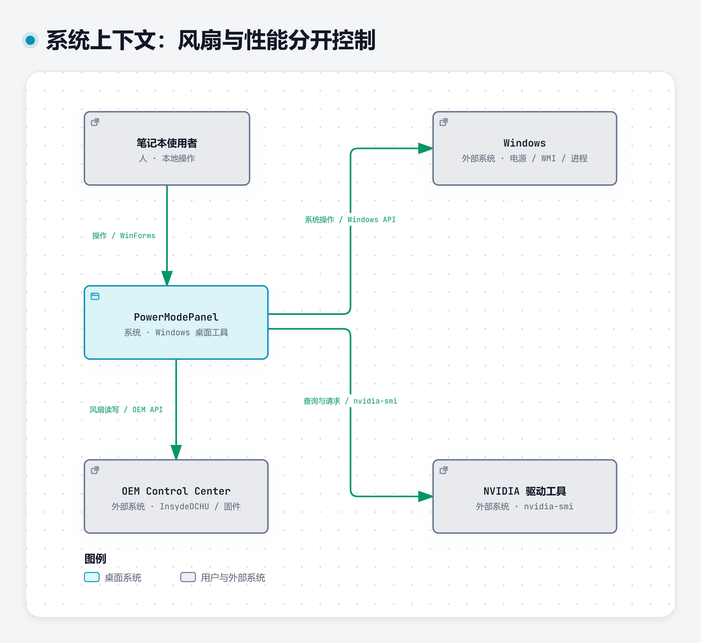

# 系统上下文

这张图将 PowerModePanel 视为一个完整的软件系统，回答它为谁工作、依赖哪些外部能力。Windows、OEM Control Center 和 NVIDIA 驱动工具都作为外部系统展示，不展开它们的内部实现。

| 元素 | C4 类型 | 职责与边界 |
|---|---|---|
| 笔记本使用者 | Person | 在本机选择风扇、性能、监测与后台处理操作。 |
| PowerModePanel | Software System | Windows 桌面工具，提供独立低噪风扇和电源档等入口。 |
| Windows | External System | 提供电源策略、WMI 监测和进程 API。 |
| OEM Control Center | External System | 已安装的 OEM native DLL、驱动和固件提供风扇读写。 |
| NVIDIA 驱动工具 | External System | `nvidia-smi` 返回 GPU 指标，并接收脚本的功耗请求。 |

| 调用方 → 目标 | 操作与技术 | 实现依据 | 状态 |
|---|---|---|---|
| 使用者 → PowerModePanel | 点击 WinForms 操作按钮 | [MainForm 与事件接线](../../PowerModePanel.cs#L43) | 已实现 |
| PowerModePanel → Windows | 调整电源、采样指标和操作进程；Windows API、WMI、`powercfg` | [监测入口](../../PowerModePanel.cs#L276)、[电源恢复](../../PowerModePanel.cs#L369)、[LibraryMode.ps1](../../LibraryMode.ps1)、[PerformanceCoolMode.ps1](../../PerformanceCoolMode.ps1) | 已实现 |
| PowerModePanel → OEM Control Center | 经 native DLL 读写风扇模式、曲线和状态 | [FanController](../../PowerModePanel.cs#L1065) | 已实现，仅已验证机型布局 |
| PowerModePanel → NVIDIA 驱动工具 | 查询 GPU 指标；脚本请求功耗限制 | [GetGpuInfo](../../PowerModePanel.cs#L1011)、[LibraryMode.ps1](../../LibraryMode.ps1) | 已实现；驱动可能拒绝功耗设置 |

独立风扇入口只进入 `FanController`，不会执行性能脚本，也不会写 Windows 电源或 GPU 设置。性能档入口则会修改 CPU 电源策略；二者在界面与调用链上分开。

[Archify JSON](../../assets/diagrams/c4-context.json) · [本地交互 HTML](../../assets/diagrams/c4-context.html) · [主题自适应 SVG](../../assets/diagrams/c4-context.svg) · [C4 Mermaid 源](../../assets/diagrams/c4-context.mmd)
