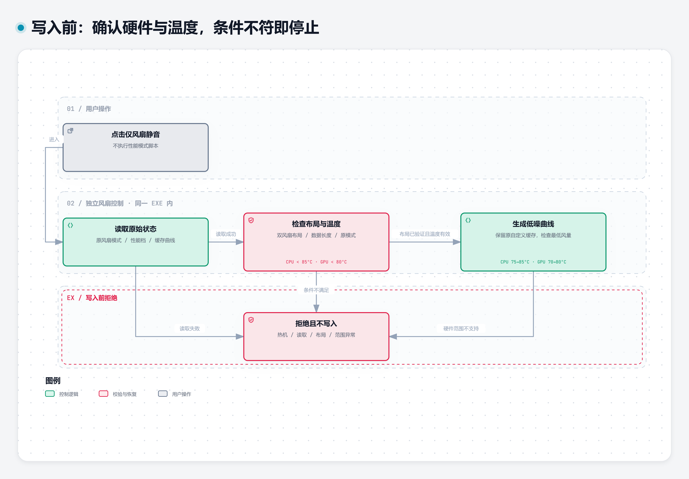
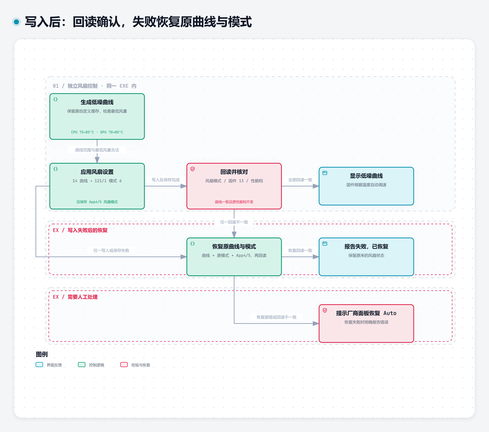

# 一次独立低噪风扇操作

这两张图共同说明一次“仅风扇静音”的完整路径。第一张按写入前检查职责组织，第二张从候选曲线继续到写入、确认和失败恢复。两图之间重复的“生成低噪曲线”是同一步，不会执行两次。

## 写入前：确认适用条件

程序读取原风扇模式、整机性能档、OEM 缓存曲线和固件布局。未知模式、长度错误、未经验证的双风扇布局、不支持的最低风量或温度范围，都会在写入前报错。实际代码先生成候选曲线，再读取温度作最后检查：CPU 温度为 0 或达到 85°C，或者 GPU 达到 80°C，均拒绝降低风扇。

候选曲线低负载目标约 25%。CPU 在 75–85°C 区间加速，GPU 在 70–80°C 区间加速，分别在 85°C 和 80°C 达到全速。它是一条由固件执行的温控曲线，不是长期固定 25% 转速。

[可编辑 JSON](../../assets/diagrams/fan-preflight.json) · [本地交互 HTML](../../assets/diagrams/fan-preflight.html) · [主题自适应 SVG](../../assets/diagrams/fan-preflight.svg)

## 写入后：确认结果或恢复

确认适用后，程序使用 OEM 命令 `14` 应用曲线，再用 `121/1` 切到自定义风扇模式 `6`。仅在 OEM 设置页 `4`、索引 `5` 保存风扇模式，不覆盖原缓存自定义曲线。随后核对模式、固件包 `13` 的曲线，以及整机性能档是否仍与操作前一致。

任一步写入、保存或回读失败，都会尝试恢复原曲线和原风扇模式，并再次核对恢复结果。已启用过低噪曲线时也会识别此前实际曲线，避免恢复成另一条配置。恢复失败的错误会明确提示使用厂商风扇面板恢复 Auto。

“恢复自动风扇”使用原缓存曲线与模式 `0`。独立风扇路径不写 Windows 电源、GPU 或整机性能档；若检测到性能档同时变化，会报错并恢复风扇状态，不会擅自覆盖外部发生的性能档变更。

[可编辑 JSON](../../assets/diagrams/fan-apply-recovery.json) · [本地交互 HTML](../../assets/diagrams/fan-apply-recovery.html) · [主题自适应 SVG](../../assets/diagrams/fan-apply-recovery.svg)

实现依据：[界面调用与反馈](../../PowerModePanel.cs#L880)、[Apply 的前置校验、写入与恢复](../../PowerModePanel.cs#L1122)、[曲线序列化与识别](../../PowerModePanel.cs#L1183)、[QuietCurve 和硬件模式命令](../../PowerModePanel.cs#L1217)。本流程说明代码实现；跨机型兼容性、满载性能与声压级不因图表完整而得到额外保证。
